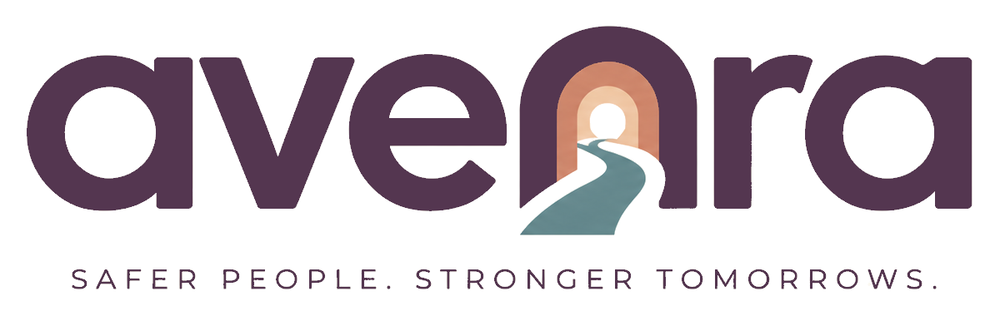

<div align="center">
  
  <h1>Avenra</h1>
  <p><strong>A new avenue to support.</strong></p>
  <p>
    <a href="https://avenra-delta.vercel.app/survivor/">Open the app</a> ·
    <a href="https://avenra-delta.vercel.app/login">Open the dashboard</a> ·
    <a href="https://avenra-delta.vercel.app/survivor/install.html">Install guide</a> ·
    <a href="https://github.com/layhadarries/Avenra/wiki">Project wiki</a>
  </p>
</div>

Avenra is a mobile-first safety and support prototype built for the **FNB hackathon GBV track**. It pairs **Clear Sky**, a discreet, installable Progressive Web App, with a staff dashboard for authorised responders and support organisations.

**Prototype use:** use fictional data for demonstrations and testing. Avenra is not an emergency-response guarantee or approved for real survivor data and operational case management.

## Development branches

| Branch | Purpose |
| --- | --- |
| [`tazio`](https://github.com/layhadarries/Avenra/tree/tazio) | Active personal development, hardening and documentation. |
| [`main`](https://github.com/layhadarries/Avenra/tree/main) | Preserved hackathon snapshot. |

Continue development on `tazio`; keep `main` in its hackathon state. Finish each code task and its checks before making one final commit and one push to `tazio`.

## What it does

### Clear Sky

- Weather-style entry screen, local PIN access and Quick Exit.
- Installable app shell with public-only offline caching.
- Account-bound alert and encrypted diary queues with retry and verified receipts.
- Device pairing, recovery, trusted contacts and opt-in notifications.
- Consent-aware location sharing, private diary notes and photo integrity checks.

### Staff dashboard

- Email invitations, password recovery, authenticator MFA and global sign-out.
- Administrator, responder and shelter roles with case and shelter access controls.
- Alert acknowledgement, case workflow, referrals and support-directory searches.
- Consent-gated shared diary access and audited activity.

Administrators have case-wide read/workflow visibility. Destructive retention and evidence deletion still require explicit case assignment. See [staff access and account operations](https://github.com/layhadarries/Avenra/wiki/Staff-accounts-and-email).

## Current status

The latest verified application checkpoint is **`bf26d70` (2026-10-29)**. All four [CI jobs passed](https://github.com/layhadarries/Avenra/actions/runs/40860446230): secret/private-file protection, security, and regression suites on Python 3.12 and 3.14, including browser checks.

The public demo links above are separate from branch verification; the latest `tazio` changes have not been verified as deployed. Application SMS delivery and hosted backup/restore verification remain outstanding. See [verification and status](https://github.com/layhadarries/Avenra/wiki/Verification-and-status) for evidence and limits.

## Stack

| Area | Technologies |
| --- | --- |
| Backend | Python, Flask, Gunicorn |
| Dashboard and PWA | HTML, CSS, JavaScript, Service Worker, IndexedDB |
| Data | SQLite locally; Supabase PostgreSQL over verified TLS when hosted |
| Integrations | SMTP, opt-in Web Push and Twilio SMS |
| Verification | Python unittest, Node.js, Playwright, security and dependency gates |

## Getting started

Requirements: Python **3.12 or 3.14**, Node.js **24** for the JavaScript checks, and **Fish** for these commands.

```fish
git clone --branch tazio https://github.com/layhadarries/Avenra.git
cd Avenra
make set-up
source .venv/bin/activate.fish
python tools/prepare_dashboard.py
source ~/.local/share/avenra-dashboard/runtime.fish
make run
```

Open `http://127.0.0.1:5050`. The local runtime starts without demo accounts; follow the [developer setup guide](https://github.com/layhadarries/Avenra/wiki/Developer-setup) to configure staff access and testing. Keep private configuration outside Git.

## Documentation

Detailed guides live in the [project wiki](https://github.com/layhadarries/Avenra/wiki).

| Guide | Contents |
| --- | --- |
| [Developer setup](https://github.com/layhadarries/Avenra/wiki/Developer-setup) | Local runtime, dependencies and branch workflow. |
| [Staff accounts and email](https://github.com/layhadarries/Avenra/wiki/Staff-accounts-and-email) | SMTP, invitations, access policy, password recovery and MFA. |
| [Notifications](https://github.com/layhadarries/Avenra/wiki/Notifications) | Web Push, SMS configuration and delivery states. |
| [Deployment and recovery](https://github.com/layhadarries/Avenra/wiki/Deployment-and-recovery) | Hosted configuration, additive upgrades, backups and restore drills. |
| [Verification and status](https://github.com/layhadarries/Avenra/wiki/Verification-and-status) | Test commands, CI evidence and current verification limits. |
| [Architecture and roadmap](https://github.com/layhadarries/Avenra/wiki/Architecture-and-roadmap) | Project layout, design references and remaining pilot work. |

Versioned technical reports and historical checkpoints remain in [`docs/`](docs/).
